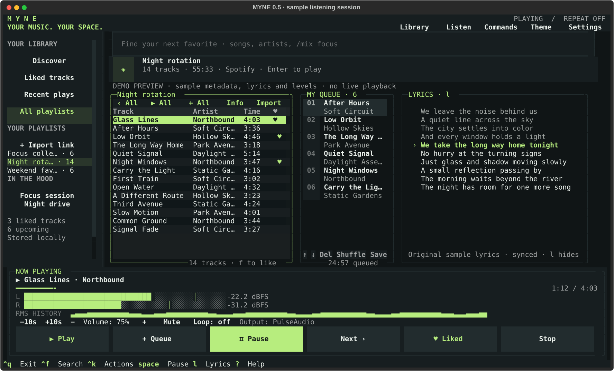
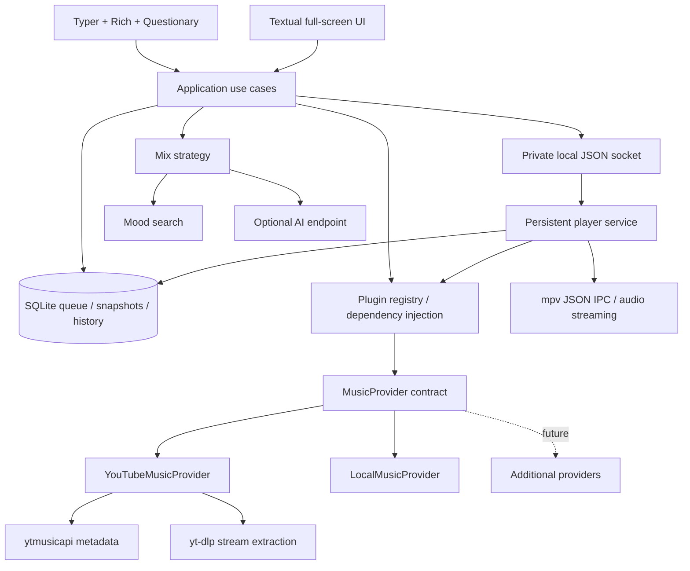

# Myne CLI

**My Music. My Queue. My Experience. Myne CLI.**

A terminal-first music player for Python 3.12+, built around provider-owned
metadata, direct audio streams, a persistent SQLite queue and an mpv player
service. Run a quick command or spend the evening in the full-screen interface.

```sh
myne search "Linkin Park"
myne play "Numb"
myne queue add "Breaking the Habit"
myne now
myne ui
```

## Install

Linux and macOS are supported. Install **Python 3.12+** and **mpv**, then:

```sh
git clone https://github.com/MMH-4ALL/myne-cli.git
cd myne-cli
python3 -m venv .venv
. .venv/bin/activate
python -m pip install .
myne doctor
```

See [the installation guide](docs/INSTALL.md) for OS packages, optional YouTube
authentication, local libraries, AI setup and troubleshooting. Windows playback
needs WSL with mpv and audio configured; native Windows IPC is not implemented.

## What works

- YouTube Music search, song/album/artist browsing and radio recommendations
  through `ytmusicapi`.
- Automatic lyrics from LRCLIB, with synchronized line highlighting, local
  caching, and a music-provider fallback. No lyrics API key is required.
- A live stereo audio visualizer reads real RMS and peak measurements from
  mpv's FFmpeg audio filter. Its amplitude history reflects the playing audio.
- `yt-dlp` extracts an audio stream URL with `download=False`; mpv streams it
  directly. No normal-playback code downloads complete media files. mpv may
  buffer audio in memory. There is no download command in this release.
- A background local player keeps music playing after `myne play` exits. Other
  commands and the TUI control the same player through a private Unix socket.
- Upcoming tracks persist automatically in SQLite. An interrupted current song
  is put back at the front on player restart, from the beginning. Named queue
  snapshots are available separately.
- Mood mixes (`gym`, `focus`, `night drive`, or arbitrary text), optional AI
  song suggestions, and plugin-supplied mix strategies.
- Listening time and top songs/artists; genres are counted when supplied by a
  provider. YouTube Music does not reliably expose genres, so Myne does not
  invent them.
- A full-screen Textual TUI with search, keyboard selection, a queue pane,
  playback progress, transport controls, help, lyrics and statistics.
- Local audio playback and library search, plus an explicit provider extension
  contract and opt-in Python entry-point plugins.

YouTube access depends on upstream services, region, account requirements and
extractor support. Dependencies are bounded where practical; keep `yt-dlp`
current when YouTube changes. Use music you are authorized to access.

## Commands

```sh
myne search "Linkin Park" --limit 15
myne play "Numb"                     # streams first result, replaces current song
myne play "Numb" --choose            # Questionary selector in an interactive terminal
myne play dQw4w9WgXcQ                # a video ID
myne play "https://music.youtube.com/watch?v=dQw4w9WgXcQ"
myne album ALBUM_ID
myne album ALBUM_ID --play
myne artist ARTIST_ID
myne queue add "Faint"
myne queue show
myne queue remove 2                 # one-based position
myne queue save                     # default snapshot
myne queue save --name evening
myne queue clear
myne queue restore --name evening
myne queue saved
myne play                           # resumes current song or starts upcoming queue
myne pause                          # toggle pause
myne resume
myne next
myne seek 15
myne seek -- -10
myne volume 60
myne stop                           # retains upcoming tracks
myne now
myne lyrics
myne lyrics --lrc                    # timestamped lyrics where available
myne lyrics "Linkin Park Numb"       # lyrics without starting playback
myne lyrics --refresh                # refresh the local lyric cache
myne visualize                      # standalone live audio meters
myne visualize --seconds 20
myne mix "gym" --limit 20            # mood-search mix, adds to queue
myne mix "focus" --play
myne mix "night drive" --ai --play   # requires an AI endpoint
myne radio "Numb"
myne radio-off
myne stats
myne ui
myne plugins
myne doctor
myne shutdown                       # stops service; current song recovers on restart
myne --json now
myne --provider local search "piano"
myne play "/path/to/my/song.flac"
```

Global options such as `--json`, `--provider`, and `--data-dir` precede the
command. Add/search/mix commands do not start playback unless `--play` is set;
`myne play` without a query starts the saved upcoming queue. `play QUERY`
interrupts the current song and prepends its new tracks before existing upcoming
tracks. A normal `stop` ends the current song; a service shutdown preserves it.

Queue save/restore applies to **upcoming tracks**, excluding the current song.
Restore replaces upcoming tracks in one transaction. It does not seek or start
audio. Radio refill continues until disabled, stopped, exhausted or unavailable;
it filters duplicates within a bounded recent-history window.

Statistics commit listening segments when a song ends, is skipped, is stopped,
or the service shuts down. Paused time and seek jumps are excluded. A play counts
after 30 seconds or half of a shorter track. A killed service preserves its song
but cannot recover uncommitted listening seconds.

## TUI

`myne ui` opens the interface. Search, then select a result and press Enter to
play or `a` to queue it. The on-screen footer lists transport/help shortcuts.
The search field also accepts `/mix focus`, `/mix-ai night drive`, and
`/radio Numb`. Press `l` to show/hide lyrics and `v` to toggle the visualizer.
Wide terminals show a lyrics side panel automatically; compact terminals switch
between tracks and lyrics. Timed lines follow playback, pause and seeking. Plain
lyrics remain scrollable and show their source. Closing the TUI leaves the player
running. Network and database work runs outside the UI event loop.

The visualizer displays decoded audio RMS and peak levels on a -60 to 0 dBFS
scale; it is an amplitude meter/history, rather than a frequency spectrum. Pause,
buffering, silence and missing measurements have distinct quiet states. Minimal
mpv builds without the FFmpeg `astats` filter can continue playing with the meter
disabled. After upgrading an already-running service, run `myne shutdown` once
and start playback again to load the new feature protocol.



*Actual interface captured with sample fixture metadata; no live playback or listening history is shown.*

## Architecture



See [architecture and lifecycle details](docs/ARCHITECTURE.md), including the
foundation-to-playback implementation stages, and [the plugin guide](docs/PLUGINS.md).

## Project structure

```text
myne-cli/
├── pyproject.toml                 # installable package, myne entry point, tooling
├── requirements.txt
├── README.md
├── LICENSE
├── docs/
│   ├── INSTALL.md
│   ├── ARCHITECTURE.md
│   └── PLUGINS.md
├── examples/mood_plugin/          # complete installable mix plugin
├── src/myne/
│   ├── cli.py                    # command presentation
│   ├── tui.py                    # asynchronous terminal interface
│   ├── service.py                # application use cases
│   ├── models.py                 # immutable dataclasses
│   ├── config.py
│   ├── container.py              # dependency injection composition root
│   ├── storage.py                # SQLite transactions and statistics
│   ├── mix.py                    # mood/AI strategies
│   ├── lyrics.py                 # LRCLIB, provider fallback, LRC timing and cache
│   ├── visualizer.py             # sample-derived audio level normalization
│   ├── plugins.py                # explicit entry-point activation
│   ├── providers/{base,youtube,local}.py
│   └── playback/{client,daemon,mpv}.py
└── tests/                        # offline unit, IPC and headless TUI tests
```

## Development

```sh
python -m pip install -e '.[dev]'
pytest -q
ruff check .
mypy src/myne
python -m build
```

Tests use injected provider clients, extractors, playback engines, isolated
SQLite databases and headless TUI pilots. A fake mpv process exercises JSON IPC
without an audio device. Live upstream access and a physical sound device are
separate checks; offline tests cannot guarantee availability of a particular
YouTube song.

## Roadmap

Spotify metadata import, Discord Rich Presence, album collection management,
scrobbling, a frequency-spectrum visualizer, multi-device sync, and additional providers are
future work. They are not represented as finished integrations. The provider
and mix plugin contracts give extensions a stable place to start.

Upstream references: [ytmusicapi](https://ytmusicapi.readthedocs.io/en/stable/),
[yt-dlp embedding](https://github.com/yt-dlp/yt-dlp#embedding-yt-dlp),
[mpv JSON IPC](https://mpv.io/manual/stable/#json-ipc),
[LRCLIB API](https://lrclib.net/docs),
[FFmpeg audio statistics](https://ffmpeg.org/ffmpeg-filters.html#astats),
[Textual](https://textual.textualize.io/).
